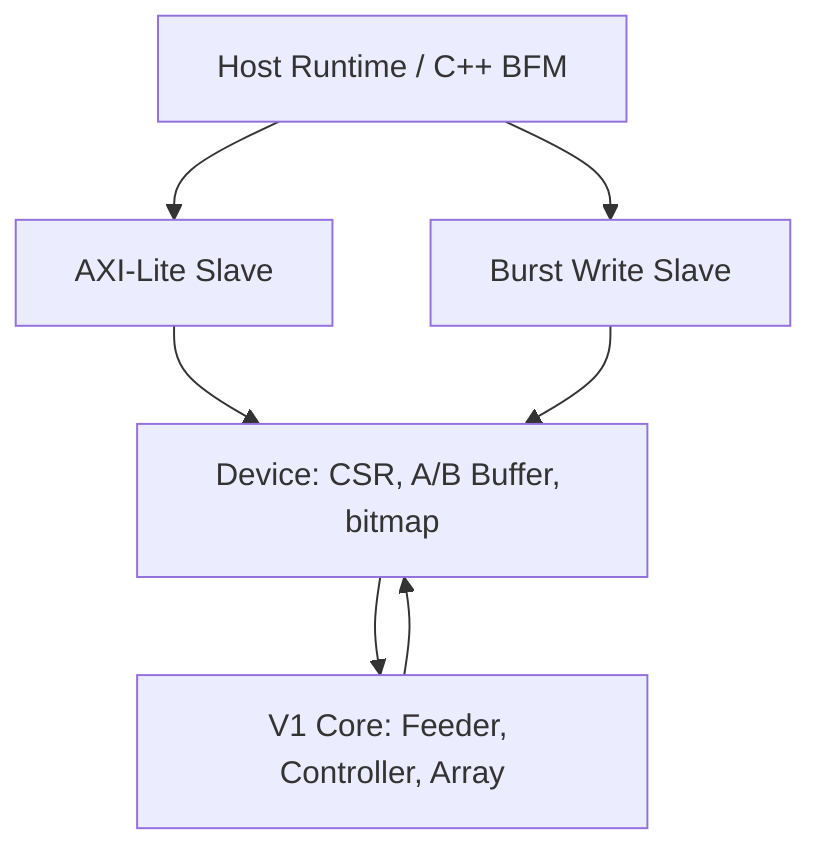

# V2 System Architecture and Task Lifetime

[English](11_system_architecture-EN.md) | [简体中文](11_system_architecture-zh_CN.md)

Updated 2026-10-30. Implemented and RTL-simulated; V2 has no physical or real-CPU performance result yet.

## 1. From V1 to V2

V1 receives complete parallel matrices. V2 stores those matrices in Wrapper, accepts bus commands and starts the frozen `systolic_array_top`. Nondeterministic Host delay stops at Wrapper; Core runs deterministically without bus backpressure entering its wavefront.

Top arbitrates two writers onto one Device write interface. Lite reads remain independent. Concurrent LOAD reads see pre-edge data and provide no whole-matrix snapshot.

## 2. Module Responsibilities

| File under rtl/wrapper/ | Responsibility |
|---|---|
| axi_lite_slave.sv | Independent AW/W capture, held B/R responses; no address semantics |
| axi_burst_write_slave.sv | Descriptor checking, address advance, WLAST, error draining and BRESP |
| systolic_device.sv | Decode, permissions, matrix register storage, written maps, task state and errors |
| systolic_axi_lite_top.sv | Preserved Lite-only baseline integration |
| systolic_axi_burst_top.sv | Write ownership and shared Device/Core, passes PACKED_ENABLE |

C directly indexes Core psum/results; there is no extra N²×18 result copy. DONE rejects new START, preserving the result throughout its readable window.

## 3. State and Ownership

| State | A/B | C | Commands |
|---|---|---|---|
| LOAD | Host reads/writes; unwritten entries read zero | RESULT_NOT_READY | START requires complete maps and core_busy=0 |
| RUN | Host reads/writes forbidden | RESULT_NOT_READY | START errors; ACK is a no-op |
| DONE | Host reads/writes forbidden | Stable Host-readable result | START errors; ACK enters LOAD and clears both maps |

Errors are sticky bits, not a blocking ERROR state; they do not abort computation. Accepted START enters RUN and registers core_start; Core samples it at the next edge, and Device later captures core_done. START BRESP is not compute completion.

## 4. Storage and Capacity

A and B each contain N*K INT8 entries; C contains N*N INT18 results. Reset does not clear input payload, but reset/ACK clear written maps and hide stale unwritten data. Full-matrix ports and register arrays do not establish SRAM/BRAM inference or a memory hierarchy.

N/K are elaboration-time parameters. Device requires N*K<=1024, N*N<=1024, DATA_W=8 and ACC_W=18. There are no runtime shape registers. Module defaults are N2/K2; performance scripts use N2/K17.

## 5. Scope

No DMA, read Burst, double buffering, internal stall, arbitrary tiling, WS or 1D mapping. Performance and physical feedback guide the next mechanism; see [co-design roadmap](../performance/18_codesign_roadmap-EN.md).
