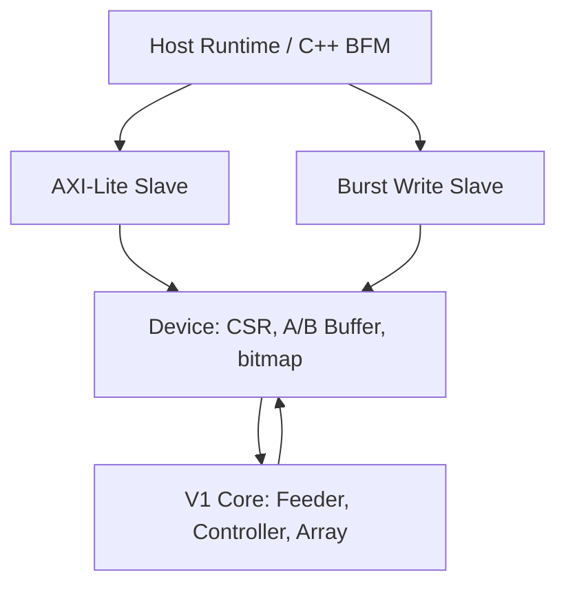

# V2 系统架构与任务生命周期

[English](11_system_architecture-EN.md) | [简体中文](11_system_architecture-zh_CN.md)

更新：2026-10-30。状态：实现并完成 RTL 仿真；尚无 V2 物理实现或真实 CPU 性能结论。

## 1. 从 V1 到 V2

V1 通过并行端口接收完整矩阵；V2 用 Wrapper 保存这些矩阵，接受总线命令，再启动冻结的 `systolic_array_top`。Host 的不确定延迟止于 Wrapper，Core 启动后按固定周期运行，总线背压不进入波前。

Lite/Burst 两个写请求通过 Top 的单写入口仲裁。Lite 读请求独立；并发 LOAD 读写观察旧值，不构成整块矩阵快照。

## 2. 模块责任

| 文件（rtl/wrapper/） | 责任 |
|---|---|
| axi_lite_slave.sv | AW/W 独立捕获、B/R 响应保持；不决定地址含义 |
| axi_burst_write_slave.sv | 描述检查、地址推进、WLAST、排空错误、汇总 BRESP |
| systolic_device.sv | 地址译码、访问权限、矩阵寄存存储、bitmap、任务状态与 sticky errors |
| systolic_axi_lite_top.sv | 原 Lite-only 集成，保留作为基线 |
| systolic_axi_burst_top.sv | 两端口写 ownership、Device 与 Core 集成，PACKED_ENABLE 参数透传 |

C 直接读取 Core 的 psum/result，不额外复制 N²×18 result buffer。DONE 状态不接受新 START，因此可读窗口内 Core 结果稳定。

## 3. 状态与 ownership

| 状态 | A/B | C | 命令 |
|---|---|---|---|
| LOAD | Host 可读写；未写元素读取零 | 读报 RESULT_NOT_READY | 完整输入且 core_busy=0 时接受 START |
| RUN | 禁止 Host 读写 | 读报 RESULT_NOT_READY | START 报错；ACK 无副作用 |
| DONE | 禁止 Host 读写 | Host 可读稳定结果 | START 报错；ACK 进入 LOAD 并清空两张 bitmap |

错误是 sticky bits，不是阻塞 ERROR 状态；非法请求不取消计算。START 接受时 Device 进入 RUN 并寄存 core_start；Core 下一边沿接收；core_done 脉冲再由 Device 捕获。不能将 START 的 B 响应解释为计算完成。

## 4. 存储组织与容量

A 有 N*K 个 INT8，B 有 K*N 个 INT8，C 有 N*N 个 INT18。数据寄存存储不在 reset 中清零，written maps 在 reset/ACK 清空，未写输入读零。当前 full-matrix 端口与寄存数组不证明 SRAM/BRAM 可推断，也不是多级存储系统。

N/K 是 elaboration-time 参数。Device 要求 N*K<=1024、N*N<=1024，DATA_W=8、ACC_W=18。软件不能写寄存器改变 shape。默认 N2/K2；性能脚本选用 N2/K17。

## 5. 下一阶段边界

未实现 DMA、AXI 读 Burst、双缓冲、内部 stall、任意尺寸 tiling、WS 或 1D 映射。先由性能与物理反馈决定下一项硬件机制，见 [co-design 路线](../performance/18_codesign_roadmap-zh_CN.md)。
